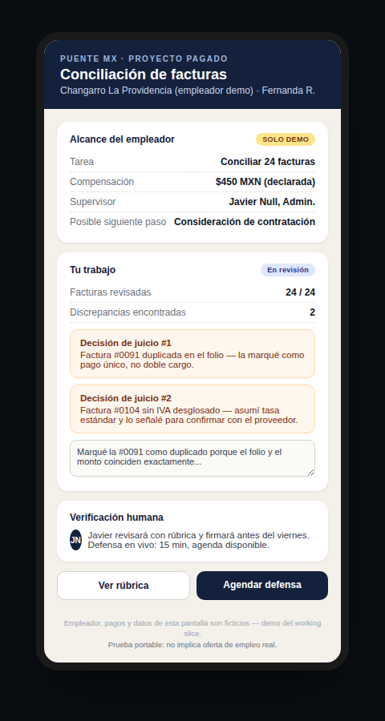
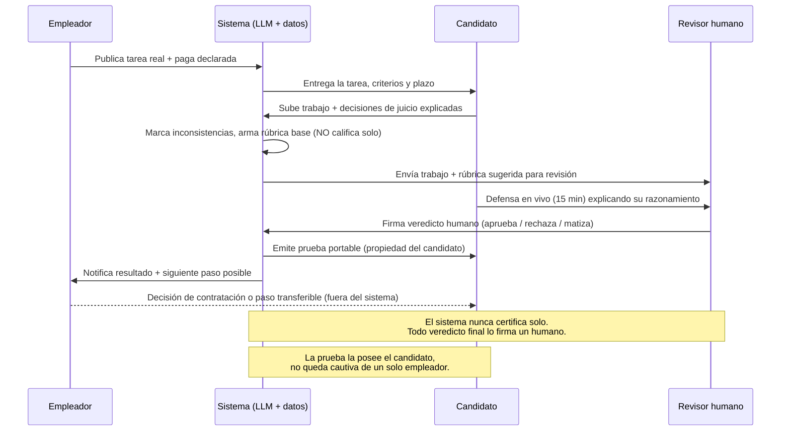

# PACKET — PUENTE MX | Work that counts

Cristina Meouchi · Crystal Ball Studio · Build individual, Semana 9 · Basado en BLUEPRINT_TEAM_Week9_Fusion.pdf

---

## 1. El problema, en mis palabras

El primer peldaño del empleo formal está desapareciendo y al mismo tiempo mucho trabajo real que la gente ya sabe hacer no cuenta para nada. Un joven no puede conseguir experiencia sin que antes lo contraten; un trabajador desplazado o informal no puede transferir fácilmente lo que ya sabe hacer a un empleador nuevo. Mi propio Brief de Adversary de la semana pasada ya documentó por qué los intentos actuales no resuelven esto: Jóvenes Construyendo el Futuro coloca al 0.4%-4% de sus inscritos cuando alguien pidió el dato auditado por transparencia, y Generation México publica 89% de colocación sin ningún rastro de verificación independiente de esa cifra. El patrón se repite: todos miden "cuántos terminan un curso," nadie mide ni audita "cuántos consiguen y conservan un trabajo real a partir de una capacidad que ya tenían."

El vacío que el equipo fusionó para esta semana no es capacitación ni colocación — es **prueba**. Generative AI además debilita portafolios y pruebas no supervisadas como evidencia confiable. Puente MX no promete empleo; construye una prueba de capacidad portátil, verificada por un humano, a partir de trabajo real y pagado — no de otro curso ni de otro badge.

## 2. El usuario exacto

**Fernanda Ruiz, 24 años, Guadalajara.** Llevó la contabilidad informal del changarro de abastarrotes de su familia durante tres años — concilia cuentas, detecta facturas duplicadas, negocia con proveedores — pero nunca tuvo un empleo formal con contrato, así que su CV está vacío donde debería estar su experiencia real. No terminó una carrera universitaria.

Fernanda es una persona diseñada a propósito para no caer limpiamente en ninguna de las dos poblaciones que el Blueprint deja como decisión abierta en la sección 9 (¿el piloto es solo para quienes buscan primer empleo, o también para trabajadores desplazados/informales?). Tiene rasgos de ambas: nunca ha tenido un trabajo formal (como alguien que busca primer empleo) y ya posee una habilidad real, no acreditada, ganada en la informalidad (como alguien desplazado o informal). El working slice de esta semana está diseñado para servirle sin necesitar que el equipo resuelva esa pregunta primero — ver sección 13.

## 3. Qué significa éxito

Antes de que cierre el módulo, Fernanda completa una tarea real y pagada de conciliación de facturas para un empleador de prueba, explica por escrito dos decisiones de juicio que tomó, agenda (o simula) una defensa en vivo de 15 minutos, y recibe una página de prueba portátil firmada por un revisor humano — que ella controla y puede enseñarle a un empleador distinto. Éxito no es "Fernanda completó un curso." Éxito es: existe un registro verificado, con nombre de supervisor, método de verificación y lo que el registro NO establece, que Fernanda posee y que sobrevive aunque el changarro de prueba deje de existir.

## 4. El working slice (mockup)

Imagen generada (ver nota de método abajo): la pantalla de **trabajo del candidato**, el segundo de los seis elementos que el Blueprint pide demostrar esta semana (alcance del empleador + compensación; envío del candidato y rastro de decisión; agendado de la defensa de 15 min; rúbrica y firma del revisor; página de prueba portátil; estatus de consideración de contratación por el empleador). Esta pantalla muestra los primeros tres: el alcance declarado del empleador de prueba, las 24 facturas conciliadas por Fernanda, sus dos decisiones de juicio explicadas en texto propio, y el botón para agendar la defensa en vivo. Las otras tres pantallas (rúbrica+firma, página de prueba, estatus de consideración) son parte del mismo flujo y se construyen en el build, no se repiten aquí para no inflar el Packet con capturas redundantes.

*Nota de método: esta sesión no tiene una herramienta de generación de imágenes por IA disponible. En su lugar construí la pantalla como HTML/CSS real y la capturé con un navegador automatizado (mismo método que usamos la semana pasada para el mockup de Primera Hora). El contenido, layout y copy son generados por mí para este Packet — no es una captura de una app ya existente.*

## 5. El loop central

```mermaid
flowchart LR
    A[Demanda del empleador<br/>publica tarea real y pagada] --> B[Tarea pagada<br/>candidato ejecuta trabajo real]
    B --> C[Trabajo observado<br/>decisiones de juicio quedan registradas]
    C --> D[Defensa en vivo<br/>15 min, candidato explica su razonamiento]
    D --> E[Verificación humana<br/>revisor firma con rúbrica]
    E --> F[Prueba portable<br/>el candidato se la lleva, no la plataforma]
    F --> G[Decisión de contratación<br/>o siguiente paso transferible]

    style A fill:#14213d,color:#fff
    style B fill:#1d2d50,color:#fff
    style C fill:#26386a,color:#fff
    style D fill:#2f4384,color:#fff
    style E fill:#38509e,color:#fff
    style F fill:#bbf7d0,color:#064e3b
    style G fill:#fde68a,color:#78350f
```

Esta es exactamente la cadena que fusionó el equipo en la sección 4 del Blueprint. No la modifiqué.

## 6. Quién hace qué

El punto que este diagrama hace explícito y que el mockup por sí solo no muestra: el LLM arma la rúbrica sugerida y resume inconsistencias, pero el flujo nunca deja que el sistema firme un veredicto por su cuenta — eso siempre pasa por el revisor humano. Esto no es decoración; es la respuesta directa de diseño a lo que yo misma ataqué en mi Brief de Adversary (cifras de colocación autorreportadas, sin rastro de auditoría).

## 7. El mejor intento del mundo (GLOBAL → LOCAL)

**Parker Dewey** (EUA) — plataforma de "micro-internships": proyectos pagados de tarifa fija ($200-600 USD), 10-40 horas, alcance definido por el empleador, reclutamiento casi exclusivamente a través de centros de carrera de universidades (CMU, Rochester, FIU, Miami Dade, USC, BU, CUNY confirmados como socios). Acertó: convierte trabajo real y pagado de corto plazo en la forma de probarte ante un empleador nuevo, exactamente el instinto detrás de Puente MX.

Lo que se rompe al cruzar a México, dos cosas distintas:

1. **El canal de distribución.** Todo el embudo de Parker Dewey corre a través de oficinas de carrera universitarias. México no tiene esa misma infraestructura para la población que Puente MX quiere servir — gente como Fernanda, sin título universitario y sin ese punto de entrada institucional.
2. **El estándar de prueba.** La "verificación" de Parker Dewey es la autoevaluación del propio empleador — sin firma de un revisor independiente, sin defensa en vivo, sin credencial portátil que el candidato se lleve a otro empleador. Es exactamente el patrón que mi Brief de Adversary ya documentó como el defecto estructural de JCF y Generation México: una cifra de éxito que nadie audita. Por eso el loop de Puente MX no copia a Parker Dewey en el paso de verificación — lo corrige con la defensa en vivo y la firma humana obligatoria.

No encontré una versión mexicana equivalente de Parker Dewey operando hoy — lo cual es consistente con el vacío que el equipo identificó.

## 8. La vista larga (3 años)

Si Puente MX funciona, en tres años trabajadores informales y de primer empleo en México construyen un registro portátil y firmado por empleadores reales de trabajo que sí hicieron, en lugar de reconstruir su credibilidad desde cero con cada empleador nuevo. La restricción que decide si esto escala no es tecnológica — es si suficientes empleadores están dispuestos a comprometer tareas pagadas reales y supervisores reales para sostener el paso de verificación humana más allá de un puñado de empresas piloto. Si ese compromiso nunca llega a una masa crítica, Puente MX se convierte silenciosamente en otro certificado-de-curso con mejor interfaz — exactamente el modo de falla que mi propio Brief de Adversary ya diagnosticó en JCF y Generation.

## 9. Scope cut — qué NO construimos esta semana

Reflejo directo de la sección 6 (Shadow) del Blueprint — estas no son omisiones por tiempo, son decisiones de diseño:

- **No hay pruebas sin pago.** Compensación, alcance y ruta de disputa se declaran antes de que el candidato empiece a trabajar.
- **No hay certificación automática por IA.** El LLM organiza y resume; nunca firma un veredicto de capacidad por sí solo.
- **No hay insignias de "trabajo no observado."** Todo lo que entra a la prueba portátil tiene que rastrearse a una tarea y una decisión de juicio específicas, con identidad del verificador visible.
- **No hay lenguaje de colocación garantizada en ningún texto de la interfaz.** Se distingue explícitamente "vacante real" de "consideración de contratación."
- **No hay CV builder ni bolsa de trabajo esta semana.** No es el vacío que estamos probando.
- **No se requiere credencial universitaria ni identificación formal para empezar una tarea.** Acceso mobile-first, bajo ancho de banda.
- **No se expone el trabajo de un candidato a un empleador nuevo sin su permiso explícito.**
- **Ningún empleador, pago o revisor en la demo es real.** Todo está etiquetado como demo en la propia interfaz (visible en el mockup).

## 10. Arquitectura — Dragon Stack

| Capa | Elección | Rol |
|---|---|---|
| Frontend | Next.js en Vercel | pantallas de tarea, envío, agendado de defensa, página de prueba |
| Auth | Supabase Auth — correo + contraseña (mismo patrón ya probado en Primera Hora) | identidad de candidato, empleador y revisor |
| Datos estructurados/verificados | Supabase Postgres, Row Level Security ON | tablas: tasks, submissions, judgment_calls, defenses, verifications, proofs |
| LLM | Gemini vía @google/genai (mismo SDK y API key ya configurados en Primera Hora) | redacta un resumen alineado a la rúbrica de las inconsistencias que el candidato señaló, para que el revisor lo lea más rápido — nunca emite el veredicto |
| Diferenciador (el "+1" del Dragon Stack) | Máquina de estados con automatización | avanza automáticamente el estatus de la tarea (asignada → enviada → defensa agendada → verificada → prueba emitida) y genera la página de prueba portátil en el instante en que el revisor firma; bloquea cualquier salto de estado — por ejemplo, no se puede emitir una prueba sin un registro de verificación firmado |

*Nota: elegí reusar exactamente el Auth (correo+contraseña) y el LLM (Gemini) que ya están probados y funcionando en Primera Hora, en vez de Google Sign-In o Claude, que habría tenido que configurar desde cero. Si tu enunciado exige específicamente "Sign in with Google," dímelo y lo cambio — es un ajuste pequeño, no un rediseño.*

## 11. Security Floor

- Sin secretos en código ni en el repo — únicamente variables de entorno en Vercel.
- Auth con Supabase (correo + contraseña, mismo patrón ya probado en Primera Hora) para cualquier dato personal (candidato, empleador, revisor).
- Row Level Security ON en toda tabla con datos de usuario — un candidato nunca puede leer el envío o la prueba de otro candidato.
- Validación de entradas en todos los formularios (sin campos de decisión de juicio vacíos, sin inyección en campos de texto libre).
- Sin datos personales reales en demos ni seeds — Fernanda Ruiz, el changarro La Providencia y Javier Null son ficticios y están etiquetados como tal en la interfaz.

*Nota: escribí esta lista de memoria de la tarea que pegaste — vale la pena que la compares línea por línea contra el enunciado original antes de entregar, por si el profesor agregó un sexto punto que no capturé.*

## 12. Plan de pruebas

**Mecánicas:**

1. RLS: el candidato A no puede leer el envío ni la prueba del candidato B vía llamada directa a la API.
2. Máquina de estados: intentar generar una prueba portátil sin un registro de verificación firmado → debe fallar.
3. Auth: una solicitud sin autenticar a cualquier tabla de datos debe ser rechazada.
4. Validación de entrada: un envío con campos de explicación de decisión de juicio vacíos debe ser rechazado.
5. Etiquetado de demo: confirmar que todo empleador, compensación y revisor en la demo aparece marcado como ficticio en la interfaz — directamente contra la cláusula de "falsa movilidad" del Shadow.

**Persona Test, capa 1:** en un chat nuevo, hacer caminar a un persona sintético (basado en Fernanda) por capturas de pantalla del flujo completo — tarea asignada → envío → agendado de defensa → página de prueba — en orden, registrar cada punto de confusión o duda, y corregir el peor antes de grabar el demo. Mismo método que usamos en Primera Hora.

## 13. Decisiones abiertas — el Blueprint no está cerrado

La sección 9 del Blueprint del equipo dice explícitamente que estas decisiones deben aprobarse antes de empezar el build: confirmar el vacío primario elegido; decidir si el piloto sirve solo a quienes buscan primer empleo o también a trabajadores desplazados; quién financia las tareas pagadas; el estándar mínimo de compromiso real de un empleador; y quién es dueño de la verificación, las salvaguardas del trabajador y la medición del piloto.

Lo que hice con eso: el vacío primario (First-Proof vía Micro-Experience) sí tiene consenso claro en el documento, así que construyo sobre eso con confianza. La pregunta de población (sección 3 de este Packet) la resolví diseñando el working slice y el persona para que sirvan a ambas poblaciones sin necesitar que el equipo decida primero — así no bloqueo mi build individual de esta semana esperando una decisión que no me toca a mí sola cerrar. Las tres preguntas restantes (quién financia, estándar mínimo de compromiso del empleador, dueño de la verificación) son decisiones de operación del piloto real, no de este working slice de demo — no afectan si el código de esta semana funciona, pero sí van a importar antes de que Puente MX salga de la fase de prototipo. Vale la pena que tu equipo las cierre en la próxima sesión de Fusion, no antes de tu entrega individual de esta semana.

## Fuentes

- Parker Dewey, página para empleadores universitarios: https://info.parkerdewey.com/employer/cmu
- BRIEF_CristinaMeouchi.md (Week 9, Adversary) — fuentes STPS/CONEVAL/Generation ya citadas ahí, no se repiten aquí.
- BLUEPRINT_TEAM_Week9_Fusion.pdf — documento fuente de este Packet, subido por Cristina.
